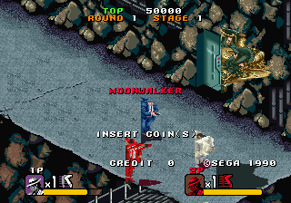
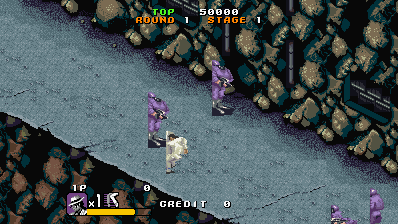

# Moonwalker (Sega System 18) — native C/C++ port

A from-scratch, native Windows/Linux/macOS runtime for **Michael Jackson's
Moonwalker** (Sega System 18, 1990), built from the user's own `mwalk.zip`
ROM set. It is not a MAME front end: the board's 68000, memory mapper, video
hardware, I/O chip and sound board are implemented in portable C/C++ and the
game's FD1094-encrypted program is executed by the native runtime.

```
mwalk.exe  ->  System 18 machine model
               |- FD1094 68000 (trace-guided static C translation)
               |- 315-5195 memory mapper
               |- 315-5296 I/O chip
               |- System 16B tilemaps + text layer + 16B sprites
               |- 315-5313 VDP (register/DMA/VRAM model; renderer WIP)
               |- Z80 sound CPU + 2 x YM3438 (ymfm)
               `- 8751 protection/sound MCU (real 8051 program)
```





## Launcher

The recommended way to play is `mwalk_launcher.exe`:

- **BROWSE** opens a native archive picker for your `mwalk.zip` (you can also
  drag the archive onto the launcher).
- **START GAME** launches `mwalk.exe` directly from the selected ZIP. The
  archive is extracted to a per-user cache, so there is no manual ROM setup.
- **SETTINGS** opens the shared neon overlay (SETTINGS and CONTROLLERS
  panels) and reopens whichever panel was used last. The same overlay is
  available inside the game with **F1**, which adds a CHEATS panel.
- **QUIT** exits the launcher.

START saves any pending settings and then runs `mwalk.exe` from the selected
archive. Sound and all key/pad bindings reach the game through
`settings.ini`, so no extra launch arguments are involved.

The launcher uses `launcher_background.jfif`, bundled Audiowide/Rajdhani
fonts, high-DPI rendering, and the same design language as the in-game
settings panel. It remembers your archive, shows live controller state, and
shares settings with the game. Settings are stored in
`%APPDATA%\MoonwalkerRecomp\Moonwalker\settings.ini` on Windows, or the
SDL preference directory on other platforms.

## Settings and video options

The overlay is shared by the launcher (SETTINGS) and the game (F1):

- **AUDIO** -- MASTER VOLUME plus a **SOUND** toggle. Sound is on by default
  (`sound_on=1`) and the toggle applies live: the SDL audio device opens or
  closes without a restart, and the choice is saved. The legacy `--audio`
  flag and `MW_AUDIO` environment variable still force sound on for a
  session.
- **DISPLAY** -- 4:3 ORIGINAL / 16:9 / 16:10 / 21:9 (see below).
- **VIDEO** -- FULLSCREEN; **SHADER** preset **OFF / SCANLINES / CRT** with
  **SCANLINE INTENSITY** (0-100%); **RESOLUTION** presets 1280x720,
  1600x900, 1920x1080 and 2560x1440, applied immediately when the game is
  running (in fullscreen the desktop size wins); and INTEGER SCALING. Shader
  presets run in source space, so every emulated line gets exactly one
  scanline at any window size: OFF is a byte-exact no-op, SCANLINES darkens
  alternate lines, CRT adds a vertical aperture grille.
- **INTERFACE** -- SHOW FPS.
- **CONTROLLERS** -- the gamepad panel described below.

## Widescreen display modes

Open **SETTINGS** in the launcher or press **F1** in the game and choose a
DISPLAY mode:

- **4:3 ORIGINAL** -- the original 320x224 framing and original culling.
  This mode is pixel-identical to the classic presentation.
- **16:9**, **16:10**, **21:9** -- the expanded field of view. The renderer
  builds a 560x224 world centered on the original 320x224 view and crops it
  symmetrically to the selected aspect ratio. The image is never stretched;
  extra world is revealed on the left and right.

Widescreen keeps the original view centered in the new frame. The expanded
sprite visibility checks stay active from boot, including during the intro,
so cutscene script state cannot change when gameplay starts. Attract and
boot screens are still presented in 4:3 by cropping the center of the same
560-wide game view. In the few map areas the original level loader never
streams beyond its 320-column window (only reachable in the outer 21:9
margin), the renderer mirrors the nearest loaded tile columns instead of
exposing a black hole.

## Current status

Working:

- ROM verification and FD1094 decryption in Python (`tools/mwalk.py`) and
  native C (`src/fd1094.c`).
- Full boot sequence through all copyright/notice screens.
- Attract mode/title screen with the isometric city background, logo, HUD,
  player panels and sprites.
- Native 320x224 framebuffer with the board's four-layer priority scheme
  (background tilemap, foreground tilemap, text, System 16B sprites). The
  sprite renderer matches MAME's `sega_sys16b` device exactly, verified
  against an independent re-implementation: transparent pixels consume a
  screen column, so zoomed sprites no longer shear or wobble.
- Keyboard input for 1–3 players, plus up to three SDL game controllers
  (auto-assigned to 1P/2P/3P, with remappable directions and buttons);
  coins, starts and service; coin/start flow reaches actual gameplay.
- Coin/start flow verified against MAME: the service-port coin edge is
  latched, credits increment at `$E000`, the start press consumes a credit,
  and the post-start mode byte `$E036` matches MAME (`0x18`). Tile RAM and
  text RAM are byte-identical at frame 1200 with the same inputs.
- NVRAM persistence: work RAM is the board's 16 KiB NVRAM (settings, high
  scores, bookkeeping). The SDL build loads/saves `nvram/mwalk/nvram`;
  `--nvram FILE` / `--no-nvram` override it.
- Fixed a 68000 recompiler bug where register bit operations (`BSET`,
  `BCLR`, `BCHG`, `BTST Dn,Dn`) were emitted as byte operations instead of
  32-bit operations. This was corrupting the palette shadow buffer during
  fades. Compiled vs Musashi at frame 1200 is now 4 bytes (2 dead stack);
  palette RAM is identical. With a fresh NVRAM and aligned MAME
  frame callbacks, tile/text RAM is byte-identical and the rendered frames
  are pixel-identical at the sampled frames (0, 1, 100, 947, 1200, 1210,
  1250). The remaining work-RAM difference is ~73-83 bytes of scratch/stack
  and live animation cells.
- 57.23 Hz frame pacing and a resizable SDL2 window.
- Full 8751 MCU execution (MIT emu8051 core) on its mapper bus, including
  the vblank IRQ4 generator, protection mailbox and sound FIFO.
- Sound board: Z80 + two YM3438 (ymfm) with music and FM effects; ymfm
  timers and the YM IRQ line are wired to the Z80. The RF5C68 PCM device is
  modelled but Moonwalker's sound program does not currently write to it.
  FM/PCM synthesis and the SDL audio device are on by default
  (`sound_on=1`); the audible path was verified against the MAME oracle
  (dance-magic WAV envelope correlation, attract/gameplay replay runs with
  no errors). With sound switched off the Z80 runs in a muted fast mode so
  the protection MCU's vblank handshake stays alive.
- Static recompilation: every reachable `(FD1094 state, PC)` pair is lifted
  to C, grouped into linked basic blocks, and dispatched through sorted
  tables. The current translation has 32,392 instruction blocks and 12,106
  basic blocks, including a ROM-wide direct-control-flow sweep of the code
  image (`0x000000-0x20FFFF`).
- Instruction-level and block-level lockstep self-tests run the translated
  core and Musashi side by side from reset for 1,000,000 instructions,
  comparing registers, SR, FD1094 state, RAM and exact per-instruction /
  per-block cycle counts.
- Coverage-guided expansion records missing blocks from randomized and
  audio-enabled runs, merges them, regenerates and repeats until convergence.
  The verified gameplay and long attract paths run without illegal-opcode
  recoveries; any remaining untranslated exception-handler entries fall back
  to Musashi and do not stop the game.
- Deterministic input replay and canonical frame hashing (`--record-input`,
  `--replay`, `--hash-file`) give byte-reproducible regression runs. Stack
  scratch is excluded from the semantic hash while the full hash remains
  available for debugging.

Not finished yet:

- Core correctness fixes, cross-checked against the MAME oracle: the lifted
  read-modify-write helpers no longer advance `(An)+`/`-(An)` twice, and
  16-bit writes to the 315-5195 mapper window now decode as a single
  low-byte register write (MAME `umask16(0x00ff)`). The vblank palette queue
  drains every frame; 60,000-frame attract and 30,000-frame gameplay runs
  complete with zero interpreter fallbacks, zero illegal opcodes and zero
  watchdog resets. The invalid-PC and palette-fade watchdogs remain as
  zero-cost safety nets.
- The VDP enable gate (315-5296 CNT2) and the plane renderer are wired and
  verified in the tested scenes. The title/intro scenes keep the VDP planes
  blank; gameplay fills VDP VRAM and renders matching backgrounds. The VDP
  sprite attribute table is all zero in the tested gameplay frame, so the
  sprite path is not exercised; the window plane is not visibly different.
- The ROM sweep covers direct control flow in the code image; a function
  reached only through an unobserved computed jump/call can still fall back
  to Musashi. `src/generated_game.c` is derived from your ROM and is
  intentionally excluded from the repository and the Windows package.
- Demo-mode P1 input values are bit-identical at the game's read points,
  but the intro task transition is still 4 frames out of phase: MAME switches
  to the gameplay task while both port CPU paths remain on the intro task.
  This is an input-pipeline/task-order difference in the board model, not a
  translated-68000 error. Sampled non-demo frames are pixel-identical.

## Building

Requirements:

- CMake 3.20+
- A C11 and C++17 compiler (GCC/Clang; MSVC also works for the runtime)
- SDL2 2.0 development files (the Windows build uses the MinGW package in
  `third_party/sdl2_dl/SDL2-2.30.11`)
- Python 3 for the ROM tools (only needed to inspect/verify the ROM)

Windows (MinGW GCC + Ninja):

```powershell
cmake -S . -B build -G Ninja -DCMAKE_C_COMPILER=gcc -DCMAKE_CXX_COMPILER=g++ -DCMAKE_BUILD_TYPE=Release
cmake --build build
.\build\mwalk_launcher.exe
```

To launch directly from an archive:

```powershell
.\build\mwalk.exe --zip mwalk.zip
```

The game still accepts `--rom-dir roms` for an already-extracted set.

To produce a portable Windows folder/ZIP (no ROM data included):

```powershell
package_windows.bat
```

Linux:

```bash
cmake -S . -B build -DCMAKE_BUILD_TYPE=Release
cmake --build build -j
./build/mwalk --rom-dir roms
```

macOS: the same CMake flow, using the SDL2 framework/package from
Homebrew or the official SDL2 DMG.

Android: the machine, FD1094, video and audio modules are portable C/C++;
the SDL2 front end maps directly to `SDL_main`/`SDLActivity`. A Gradle
project will be added in the porting step.

## ROM setup

The repository does **not** contain any game data. You must own the arcade
board/ROM set and place `mwalk.zip` in the project, then extract it:

```powershell
Expand-Archive mwalk.zip -DestinationPath roms
python tools/verify_rom.py        # CRC32 check against the MAME mwalk set
```

The runtime expects the extracted file names (`epr-13235.a6`,
`epr-13234.a5`, `317-0159.key`, `mpr-*.bin`, `315-5437.ic4`). `--zip`
extracts the archive to the per-user cache automatically; `--rom-dir`
continues to work for an extracted folder.

## Controls

| Player | Move | B1 | B2 | B3 |
| --- | --- | --- | --- | --- |
| 1P | arrow keys | Z | X | C |
| 2P | W A S D | J | K | L |
| 3P | keypad 8/4/6/2 | keypad 1 | keypad 2 | keypad 3 |

- `5` / `6` - coin 1 / coin 2
- `1` / `2` - start 1P / 2P
- `3` - start 3P (and coin 3 in individual-chute mode)
- `Tab` - service, `7`/`8` - service 1/2
- `P` - pause
- `F1` - settings overlay (SETTINGS / CONTROLLERS / CHEATS; pauses the game
  while open)
- `F5` - reset the game (also clears the cheats)
- `F11` - fullscreen
- `F12` - save a BMP screenshot of the current display crop
- `Esc` - close the settings overlay, or quit the game

## Controllers

Up to three SDL game controllers play at the same time. Pads are assigned to
1P/2P/3P in connection order; a pad assigned to a player in the
**CONTROLLERS** panel (available in the launcher and in the F1 overlay)
keeps that player even when the pads are connected in a different order, and
its slot stays reserved while it is unplugged. Pad assignment and every
key/pad binding are stored in `settings.ini`.

Default pad mapping (identical for all three players):

| Action | Pad |
| --- | --- |
| Move | D-pad or left stick |
| B1 / B2 / B3 | A / B / X |
| Start | that player's start |
| Back | that player's coin (1P: coin 1, 2P: coin 2; unused for 3P) |

- P3's start and coin 3 share one service bit (0x80) on the board, so 3P's
  pad Start fires it. P3's pad Back is unused: coin 3 does not exist in the
  pad service layout, and Back is not one of the rebindable actions.
- Pads of the same model report the same GUID, so two identical controllers
  cannot be told apart by the assignment row; they fall back to connection
  order.
- To rebind, click a KEY or PAD chip and press the new key/button (`Esc`
  cancels). Bindings persist in `settings.ini` and are shared by the launcher
  and the game.

## Cheats

Open the in-game overlay with **F1** and select the **CHEATS** panel. The
four cheats are global (they cover 1P, 2P and 3P), session-only, applied to
work RAM after every frame, never written to `settings.ini`, and cleared by
**F5** or when the game exits:

- **INFINITE LIVES** -- freezes each active player's lives so the counter
  never runs out.
- **INVINCIBILITY** -- freezes player health so damage cannot kill.
- **INFINITE MAGIC** -- refills the dance magic charge every frame.
- **FREE CREDITS** -- holds 9 credits on the counter (works before a game
  starts too).

The HUD digits are drawn from the value captured at the start of a frame, so
a freeze can show up one frame late; judge it by surviving, not by the digit.
Act select is not supported: the act byte has no verified write window
(writes revert within 1-2 frames or corrupt the player object).

## Static recompilation

`src/generated_game.c` is not committed. The build uses
`src/generated_game_empty.c` (Musashi only) when it is absent. To rebuild the
translated program from your own ROM:

```powershell
cmake -S . -B build_trace -G Ninja -DCMAKE_C_COMPILER=gcc `
    -DCMAKE_CXX_COMPILER=g++ -DCMAKE_BUILD_TYPE=Release -DMW_ENABLE_TRACE=ON
cmake --build build_trace --target mwalk_headless
.\build_trace\mwalk_headless.exe --rom-dir roms --frames 6000 --play `
    --record build\trace.txt
python tools\gen_recomp.py build\trace.txt
cmake --build build
```

`build/trace.txt` records executed `(state, PC)` pairs. By default the
generator also sweeps the code image for direct branch/call/jump targets and
closes over vectors, FD1094 state changes and PC-indexed jump tables. Use
`--no-sweep` for a fast trace-only build, or `--sweep-limit 0xNNNNNN` to
change the code-image boundary. `tools/expand_trace.py` automates the
record/merge/regenerate/rebuild loop with randomized inputs.

The generated file is game code derived from the ROM: do not redistribute
it. At run time, `MW_NO_RECOMP=1` forces the Musashi interpreter for
comparison, and `MW_RECOMP_LOG=path` writes the executed block sequence.

Deterministic replay and frame hashing:

```powershell
# record inputs and per-frame hashes
.\build\mwalk_headless.exe --rom-dir roms --frames 6000 --demo `
    --record-input build\inputs.txt --hash-file build\hashes.txt

# replay exactly the same run
.\build\mwalk_headless.exe --rom-dir roms --frames 6000 `
    --replay build\inputs.txt --hash-file build\hashes_replay.txt
```

The two hash files are byte-identical for a deterministic build. Random
input runs use `--random SEED`; seeds are reproducible across machines.

## Playable demo and inputs

`mwalk.exe --demo` is the quickest way to see the game running. It waits for
the attract screen, inserts a coin at frame 900, starts 1P at frame 1000 and
then holds direction/attack inputs. The SDL build keeps settings/high scores
in `nvram/mwalk/nvram`; use `--no-nvram` for a clean boot or `--nvram FILE`
for a specific image. The same schedule is available headless:

```powershell
.\build\mwalk_headless.exe --rom-dir roms --frames 3000 --demo --dsw 0xED
```

The headless input recorder can capture and replay any of these runs with
`--record-input` / `--replay`.

## Validation with MAME

MAME 0.289 is used as the oracle:

Create a MAME-visible copy of the set first (MAME wants a zip or a directory
named `mwalk`):

```powershell
New-Item -ItemType Directory -Force refroms | Out-Null
Copy-Item mwalk.zip refroms\mwalk.zip
```

```powershell
# capture frames at fixed emulated times
.\tools\mame_dist\mame.exe mwalk -rompath refroms -video d3d -sound none `
    -nothrottle -seconds_to_run 60 -snapname ref_%i -snapsize 320x224 `
    -autoboot_script tools\mame_ref\capture_attract.lua

# headless frame from our runtime
.\build\mwalk_headless.exe --rom-dir roms --frames 2400 --shot build\ours.bmp
```

The lockstep self-tests are the primary recompiler regressions:

```powershell
# exact instruction semantics and cycles
.\build\mwalk_headless.exe --rom-dir roms --selftest 1000000

# exact basic-block grouping, links and cycles
.\build\mwalk_headless.exe --rom-dir roms --block-selftest 1000000

# coverage / fallback check
.\build\mwalk_headless.exe --rom-dir roms --frames 50000 --random 21
```

`tools/mame_ref/` contains the Lua scripts used to capture screenshots and
dump the board's memory shares (`:tileram`, `:textram`, `:sprites`,
`:paletteram`, `:workram`). The tile RAM dump at frame 2400 is byte-identical
between MAME and this runtime, which is the current graphics regression test.

## Repository layout

```
src/
  main_sdl.c        SDL2 window, input, audio device, pacing
  main_headless.c   automated frame/memory/audio dump tool
  s18.c/.h          System 18 machine: bus, mapper, I/O, palette, VDP ports
  fd1094.c/.h       Hitachi FD1094 key/state machine and ROM decryption
  m68k_glue.c       Musashi ABI: separate instruction/data buses, FD1094 hooks
  recomp.c/.h       native 68000 state, EA/flag helpers, block dispatcher
  generated_game.c  ROM-derived translated blocks (generated, not shipped)
  video.c/.h        System 16B tilemaps, text, sprites, VDP plane compositor
  mcu.c/.h          8751 MCU, mapper bus, vblank/sound interrupt wiring
  sound.cpp/.h      Z80 + 2 x YM3438, RF5C68, ymfm timers, audio ring buffer
  rom_loader.c/.h   extracted-ROM loader
third_party/
  musashi/          MIT 68000 core (Karl Stenerud)
  z80/              MIT Z80 core (Nicolas Allemand)
  ymfm/             BSD-3 FM synthesis (Aaron Giles)
  emu8051/          MIT 8051 core (Jari Komppa)
  sdl2_dl/          SDL2 MinGW development package
tools/
  mwalk.py          FD1094 decryption + ROM loading
  verify_rom.py     CRC32 verification
  gen_recomp.py     trace/ROM decoder + basic-block C emitter
  expand_trace.py   coverage-guided record/merge/regenerate loop
  analyze_trace_ops.py  instruction/mode coverage report for a trace
  dis1.py           decode instructions at a (FD1094 state, PC)
  imgdiff.py        pixel-exact screenshot comparison
  mame_ref/         MAME Lua oracle scripts
```

## Legal

Moonwalker, its graphics, sound and program code are copyright Sega and the
respective rights holders. This repository contains only original runtime
code and tooling; it ships no ROM data and no translated game code. You must
supply your own legally obtained ROM set. Do not redistribute ROMs,
`src/generated_game.c`, or binaries built with it; a locally built
`mwalk.exe` and the `dist` package contain translated game code derived
from your ROM.

The original code in this repository is provided under the MIT license (see
`LICENSE`). Third-party components keep their own licenses; see
`third_party/README.md`.

## Next steps

1. Implement the 315-5313 plane/window/sprite renderer fully (the current
   code handles plane A/B only); verify the remaining background gradients.
2. Verify the RF5C68 PCM path if a later sound revision starts using it.
4. Grow trace coverage (death/continue, all stages) so the Musashi fallback
   is needed less often, and tighten cycle accounting for exact attract-mode
   parity.
5. Add save states and the remaining packaging targets (Linux AppImage,
   macOS .app, Android APK).
